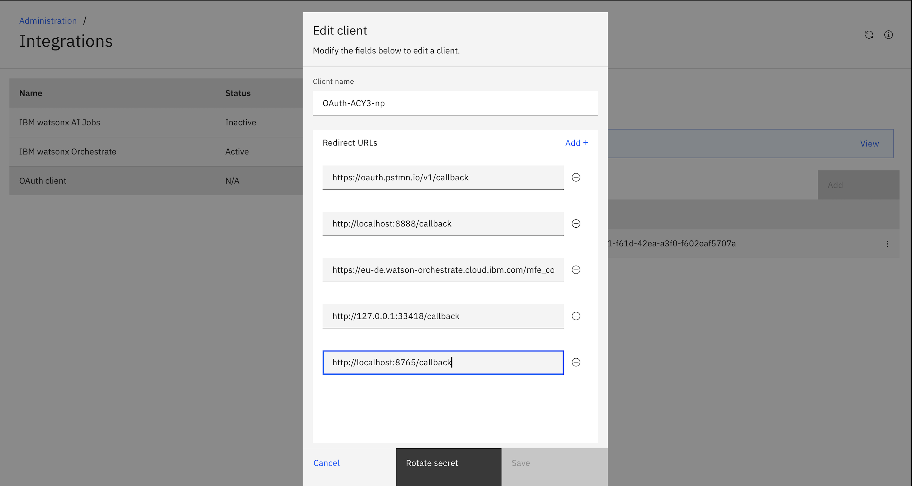
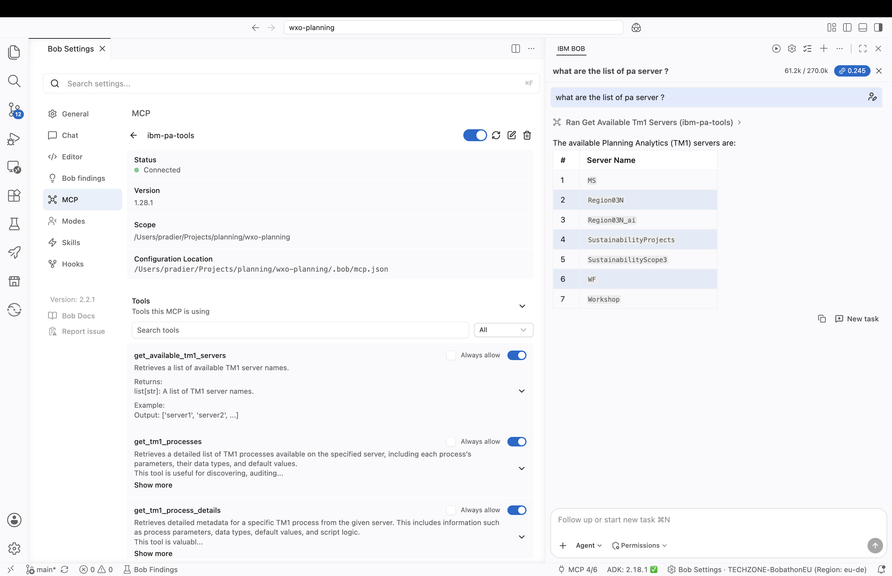

# Connect IBM Bob to IBM Planning Analytics via OAuth 2.0

This guide walks you through connecting IBM Bob (the AI assistant) to an IBM Planning Analytics (PA) instance using a local Python MCP bridge. Once connected, Bob can use all of the PA Agent's prebuilt tools — cube exploration, sandbox management, impact analysis, outlier detection, TI process monitoring, and more — directly from the chat.

This document is self-contained and can be followed without access to any specific repository.

---

## Prerequisites

| Requirement | Details |
|---|---|
| IBM Planning Analytics instance | Cloud-hosted (e.g. `<tenant>.planning-analytics.cloud.ibm.com`) |
| PA Agent feature entitlement | Required on the PA instance to expose the MCP endpoint |
| Bob IDE | Installed and running locally |
| Python 3.9+ | Available on your machine |
| `pip` / `venv` | Standard Python packaging tools |

---

## Overview

The integration works as follows:

```
Bob (IDE) ──stdio (local)──> pa_mcp_server.py ──HTTPS + OAuth2──> PA Agent MCP endpoint
```

The Python script acts as a local MCP bridge:
1. It authenticates to Planning Analytics using OAuth2 Authorization Code flow.
2. It caches and auto-refreshes the access token.
3. It exposes two MCP tools to Bob — `list_pa_agent_tools` and `call_pa_agent_tool` — which proxy all requests to the PA Agent remote MCP endpoint.

---

## Step 1 — Register an OAuth2 Client in Planning Analytics

1. Log in to your Planning Analytics Workspace.
2. Open **Administration** (the gear icon in the top-right corner).
3. Navigate to **Integrations** in the left-hand panel.
4. Click **Add client** (or the `+` button).
5. Fill in the client registration form:
   - **Name**: give it a recognisable name (e.g. `bob-mcp-bridge`)
   - **Redirect URL**: `http://localhost:8765/callback`
     > This value must match exactly. The local bridge server listens on this port to catch the OAuth callback.
6. Click **Save** (or **Create**).
7. Copy the generated **Client ID** and **Client Secret** — you will need them in Step 4.

> 
> *PA Administration → Integrations → Edit client — `http://localhost:8765/callback` added to the Redirect URLs list.*

---

## Step 2 — Set Up the Project Folder and Python Virtual Environment

All files for this integration live inside a folder called `pa-bob-connector`. If it does not exist yet, create it now:

```bash
mkdir -p pa-bob-connector
```

Next, create the dependencies file. If `pa-bob-connector/requirements.txt` does not exist, create it with the following content:

**`pa-bob-connector/requirements.txt`**

```
requests
mcp<2
```

Then, from the directory that contains `pa-bob-connector/`, create a virtual environment and install the dependencies:

```bash
python3 -m venv .venv
source .venv/bin/activate          # macOS / Linux
# .venv\Scripts\activate           # Windows

pip install -r pa-bob-connector/requirements.txt
```

---

## Step 3 — Create (or Obtain) the MCP Bridge Script

The MCP bridge is a single Python file: `pa-bob-connector/pa_mcp_server.py`.

It reads configuration exclusively from environment variables — no `.env` file is used:

| Variable | Required | Description |
|---|---|---|
| `PA_HOST` | ✅ | PA hostname without `https://` or trailing slash (e.g. `your-instance.planning-analytics.cloud.ibm.com`) |
| `PA_CLIENT_ID` | ✅ | OAuth2 Client ID from Step 1 |
| `PA_CLIENT_SECRET` | ✅ | OAuth2 Client Secret from Step 1 |
| `PA_TENANT_ID` | ❌ | Tenant ID for PAaaS instances only. Leave unset for standard PA on Cloud. |
| `PA_REDIRECT_URI` | ❌ | Defaults to `http://localhost:8765/callback`. Only override if you changed the port. |
| `PA_AGENT_MCP_URL` | ❌ | Override the PA Agent MCP endpoint URL. Auto-derived from `PA_HOST` if unset. |

The script exposes two MCP tools to Bob:

- **`list_pa_agent_tools`** — Returns all tools available on the remote PA Agent MCP server.
- **`call_pa_agent_tool(tool_name, arguments)`** — Calls a specific PA Agent tool by name.

---

### Option A — You have access to the repository

If you have access to the project repository, you can copy the script directly from:

**[`pa-bob-connector/pa_mcp_server.py`](https://github.com/your-org/your-repo/blob/main/pa-bob-connector/pa_mcp_server.py)**

Place the file at `pa-bob-connector/pa_mcp_server.py` relative to the directory where you created `.venv` in Step 2.

---

### Option B — You do not have access to the repository

Create the file `pa-bob-connector/pa_mcp_server.py` manually and paste the full code below into it.

**`pa-bob-connector/pa_mcp_server.py`**

```python
"""
Minimal local MCP bridge: Bob (IDE) <-> IBM Planning Analytics (PA)

Works with both kinds of PA deployment:
  - PA on Cloud, no tenant ID (e.g. mycompany.planning-analytics.cloud.ibm.com):
    leave PA_TENANT_ID unset.
  - PA as a Service, tenant based (e.g. us-east-1.planninganalytics.saas.ibm.com):
    set PA_TENANT_ID to the tenant ID shown in the PA Workspace URL.

Architecture:
  Bob (IDE) --stdio (local, trusted)--> this script --HTTPS + OAuth--> PA Agent MCP endpoint

Setup:
  1. In PA Workspace: Administration -> Integrations -> Add client
     - Redirect URL: http://localhost:8765/callback   (must match PA_REDIRECT_URI below exactly)
     - Copy the generated Client ID and Client Secret. You will paste them directly
       into .bob/mcp.json (no .env file is used by this script).
  2. pip install -r requirements.txt
  3. Add this script to .bob/mcp.json, with PA_HOST, PA_CLIENT_ID, and
     PA_CLIENT_SECRET set in its "env" block. Also set PA_TENANT_ID there if your
     instance uses one (see the setup guide for the exact format).
  4. Restart Bob. The first tool call will pop your browser for PA login.
     After that, tokens are cached and refreshed automatically until the refresh
     token itself expires, at which point it will pop the browser again.

This script:
  - Runs a tiny local HTTP server on the callback port, just to catch PA's OAuth
    redirect (the ?code=... query param).
  - Exchanges that code for an access_token + refresh_token at PA's /oauth2/token.
  - Caches tokens on disk (token_cache.json) and refreshes automatically.
  - Proxies IBM's prebuilt "PA Agent" remote MCP tools (list_pa_agent_tools /
    call_pa_agent_tool) by connecting to it as a client with that token.
    Requires the PA Agent feature entitlement on this PA instance.
"""

import os
import json
import time
import threading
import webbrowser
from http.server import BaseHTTPRequestHandler, HTTPServer
from urllib.parse import urlparse, parse_qs, urlencode

import requests
from mcp.server.fastmcp import FastMCP
from mcp import ClientSession
from mcp.client.streamable_http import streamablehttp_client

PA_HOST = os.environ["PA_HOST"]  # e.g. mycompany.planning-analytics.cloud.ibm.com (no https://, no trailing slash)
PA_TENANT_ID = os.environ.get("PA_TENANT_ID", "").strip()  # leave unset for a no-tenant PA on Cloud instance
CLIENT_ID = os.environ["PA_CLIENT_ID"]
CLIENT_SECRET = os.environ["PA_CLIENT_SECRET"]
REDIRECT_URI = os.environ.get("PA_REDIRECT_URI", "http://localhost:8765/callback")
TOKEN_CACHE_PATH = os.path.join(os.path.dirname(__file__), "token_cache.json")

AUTH_URL = f"https://{PA_HOST}/oauth2/authorize"
TOKEN_URL = f"https://{PA_HOST}/oauth2/token"

# IBM's prebuilt "PA Agent" remote MCP endpoint (requires PA Agent feature entitlement).
# Tenant-based PAaaS instances need the tenant ID in the path; no-tenant PA on Cloud
# instances omit it. PA_TENANT_ID being empty or unset covers the no-tenant case.
_tenant_segment = f"{PA_TENANT_ID}/" if PA_TENANT_ID else ""
PA_AGENT_MCP_URL = os.environ.get(
    "PA_AGENT_MCP_URL",
    f"https://{PA_HOST}/api/{_tenant_segment}v0/agentic-ai/ibm-pa-tools/mcp",
)

_callback_result = {}


class _CallbackHandler(BaseHTTPRequestHandler):
    def do_GET(self):
        parsed = urlparse(self.path)
        if parsed.path != urlparse(REDIRECT_URI).path:
            self.send_response(404)
            self.end_headers()
            return
        params = parse_qs(parsed.query)
        _callback_result["code"] = params.get("code", [None])[0]
        _callback_result["error"] = params.get("error", [None])[0]
        self.send_response(200)
        self.send_header("Content-Type", "text/html")
        self.end_headers()
        msg = "Login successful, you can close this tab." if _callback_result.get("code") else "Login failed."
        self.wfile.write(f"<html><body><h3>{msg}</h3></body></html>".encode())

    def log_message(self, *args):
        pass  # silence default request logging


class _CallbackHTTPServer(HTTPServer):
    allow_reuse_address = True  # avoid "Address already in use" if a prior socket is in TIME_WAIT


def _run_local_callback_server(port: int):
    server = _CallbackHTTPServer(("localhost", port), _CallbackHandler)
    server.handle_request()  # handle exactly one request, then stop


def _load_cached_token():
    if os.path.exists(TOKEN_CACHE_PATH):
        with open(TOKEN_CACHE_PATH) as f:
            return json.load(f)
    return None


def _save_token(token: dict):
    token["obtained_at"] = time.time()
    with open(TOKEN_CACHE_PATH, "w") as f:
        json.dump(token, f)


def _token_expired(token: dict) -> bool:
    expires_in = float(token.get("expires_in", 3600))  # PA's token endpoint may return this as a string
    obtained_at = float(token.get("obtained_at", 0))
    return time.time() > obtained_at + expires_in - 60  # refresh 60s early


def _refresh_token(token: dict) -> dict:
    resp = requests.post(TOKEN_URL, data={
        "grant_type": "refresh_token",
        "refresh_token": token["refresh_token"],
        "client_id": CLIENT_ID,
        "client_secret": CLIENT_SECRET,
    })
    resp.raise_for_status()
    new_token = resp.json()
    _save_token(new_token)
    return new_token


def _interactive_login() -> dict:
    port = int(urlparse(REDIRECT_URI).port or 8765)
    server_thread = threading.Thread(target=_run_local_callback_server, args=(port,), daemon=True)
    server_thread.start()

    params = {
        "response_type": "code",
        "client_id": CLIENT_ID,
        "redirect_uri": REDIRECT_URI,
        "scope": "v0userContext",
    }
    webbrowser.open(f"{AUTH_URL}?{urlencode(params)}")

    server_thread.join(timeout=180)  # wait up to 3 min for the user to log in
    if not _callback_result.get("code"):
        raise RuntimeError(f"PA login failed or timed out: {_callback_result.get('error')}")

    resp = requests.post(TOKEN_URL, data={
        "grant_type": "authorization_code",
        "code": _callback_result["code"],
        "redirect_uri": REDIRECT_URI,
        "client_id": CLIENT_ID,
        "client_secret": CLIENT_SECRET,
    })
    resp.raise_for_status()
    token = resp.json()
    _save_token(token)
    return token


def get_access_token() -> str:
    token = _load_cached_token()
    if token and not _token_expired(token):
        return token["access_token"]
    if token and token.get("refresh_token"):
        try:
            token = _refresh_token(token)
            return token["access_token"]
        except requests.HTTPError:
            pass  # refresh failed (likely expired) -- fall through to full login
    token = _interactive_login()
    return token["access_token"]


# ---- Proxy to IBM's prebuilt "PA Agent" remote MCP tools ----

def _unwrap_exception(exc: BaseException) -> str:
    """TaskGroup/ExceptionGroup wrappers hide the real cause. Recursively pull out
    the leaf exception message(s) so tool errors are actually diagnosable."""
    if hasattr(exc, "exceptions"):  # BaseExceptionGroup (py3.11+) / anyio's ExceptionGroup
        return " | ".join(_unwrap_exception(e) for e in exc.exceptions)
    return f"{type(exc).__name__}: {exc}"


async def _call_remote_pa_agent(fn):
    """Open a session against IBM's PA Agent MCP endpoint using our OAuth bearer
    token, run `fn(session)`, and clean up. `fn` is an async callable."""
    token = get_access_token()
    headers = {"Authorization": f"Bearer {token}"}
    try:
        async with streamablehttp_client(PA_AGENT_MCP_URL, headers=headers) as (read, write, _):
            async with ClientSession(read, write) as session:
                await session.initialize()
                return await fn(session)
    except BaseException as exc:
        raise RuntimeError(
            f"PA Agent MCP call failed at {PA_AGENT_MCP_URL}: {_unwrap_exception(exc)}"
        ) from exc


mcp = FastMCP("planning-analytics-bridge")


@mcp.tool()
async def list_pa_agent_tools() -> list:
    """List the prebuilt tools available from IBM's PA Agent remote MCP server
    (natural-language cube exploration, sandbox/view management, impact analysis,
    outlier detection, TI process monitoring, etc). Call this first to see what's
    available before using call_pa_agent_tool."""
    async def _list(session):
        result = await session.list_tools()
        return [{"name": t.name, "description": t.description} for t in result.tools]
    return await _call_remote_pa_agent(_list)


@mcp.tool()
async def call_pa_agent_tool(tool_name: str, arguments: dict = None) -> dict:
    """Call a specific tool on IBM's PA Agent remote MCP server by name, with a
    dict of arguments matching what list_pa_agent_tools() describes for it."""
    async def _call(session):
        result = await session.call_tool(tool_name, arguments or {})
        return {
            "content": [getattr(block, "text", str(block)) for block in result.content],
            "isError": result.isError,
        }
    return await _call_remote_pa_agent(_call)


if __name__ == "__main__":
    mcp.run(transport="stdio")
```

After saving, your `pa-bob-connector/` folder should look like this:

```
pa-bob-connector/
├── pa_mcp_server.py       # Local MCP bridge (Python)  ← created in this step
└── requirements.txt       # Python dependencies        ← created in Step 2
```

---

## Step 4 — Register the MCP Server in Bob

Open (or create) the Bob MCP configuration file at `.bob/mcp.json` and add the following entry inside the `"mcpServers"` object.

Replace the placeholder values with your actual PA hostname and the Client ID / Secret from Step 1.

```json
{
  "mcpServers": {
    "ibm-pa-tools": {
      "command": "/path/to/your/project/.venv/bin/python",
      "args": ["/path/to/your/project/pa-bob-connector/pa_mcp_server.py"],
      "env": {
        "PA_HOST": "your-instance.planning-analytics.cloud.ibm.com",
        "PA_CLIENT_ID": "<your-client-id>",
        "PA_CLIENT_SECRET": "<your-client-secret>"
      }
    }
  }
}
```

> **Use absolute paths** for both `command` and `args`. Bob launches the MCP server as a subprocess and does not inherit your shell's working directory.

**Example with real (anonymised) values:**

```json
{
  "mcpServers": {
    "ibm-pa-tools": {
      "command": "/Users/yourname/Projects/my-project/.venv/bin/python",
      "args": ["/Users/yourname/Projects/my-project/pa-bob-connector/pa_mcp_server.py"],
      "env": {
        "PA_HOST": "your-instance.planning-analytics.cloud.ibm.com",
        "PA_CLIENT_ID": "1b86****-****-****-****-****eaf5707a",
        "PA_CLIENT_SECRET": "ddf3****************************************************3ca52ce"
      }
    }
  }
}
```

> **Windows users:** use the Python binary at `.venv\Scripts\python.exe` and use forward slashes or escaped backslashes in the JSON paths.

---

## Step 5 — Protect Your Credentials

The `mcp.json` file contains your Client Secret and should **never** be committed to version control. Add it to your `.gitignore`:

```
.bob/
```

The token cache file written by the bridge also contains sensitive tokens. Add it to `.gitignore` as well:

```
pa-bob-connector/token_cache.json
```

---

## Step 6 — Reload Bob and Authorise

1. Save `.bob/mcp.json`.
2. Restart Bob (or reload the MCP server from Bob's settings if it supports hot-reload).
3. The first time any PA tool is invoked, the bridge will open your **default browser** and redirect you to the Planning Analytics login page.
4. Log in with your PA credentials.
5. After a successful login, the browser tab shows `Login successful, you can close this tab.`
6. The bridge writes a `token_cache.json` next to the script. Subsequent tool calls use the cached token automatically. The token is refreshed silently until the refresh token itself expires, at which point the browser will be opened again.

---

## Step 7 — Verify the Connection

From the Bob chat, ask Bob to list the available PA tools:

> *"List all available Planning Analytics tools."*

Bob will call `list_pa_agent_tools` via the bridge and return a list of tools exposed by the PA Agent MCP server. A successful response confirms the entire chain — local bridge, OAuth token, and PA Agent endpoint — is working.

> 
> *Bob Settings → MCP → `ibm-pa-tools` showing **Connected** status, and a chat response listing the available TM1 servers.*

---

## Troubleshooting

| Symptom | Likely cause | Fix |
|---|---|---|
| Browser does not open on first tool call | Bob cannot launch the subprocess | Verify the `command` path points to the correct Python binary inside `.venv` |
| `Address already in use` on port 8765 | A prior server process did not exit | Kill the stale process: `lsof -ti:8765 \| xargs kill` |
| `401 Unauthorized` from PA | Token is invalid or the client credentials are wrong | Double-check `PA_CLIENT_ID` and `PA_CLIENT_SECRET` in `mcp.json`; re-run the OAuth flow |
| `404` on the MCP endpoint | PA Agent feature not entitled on the instance | Contact your PA administrator to enable the PA Agent entitlement |
| `PA_TENANT_ID` errors | Using a PAaaS (tenant-based) instance | Set `PA_TENANT_ID` in the `env` block to your tenant ID |
| Token cache stale after long idle | Refresh token expired | Delete `pa-bob-connector/token_cache.json` — the next tool call will re-open the browser |
| `ModuleNotFoundError: No module named 'mcp'` | Running the wrong Python (system, not `.venv`) | Confirm the `command` in `mcp.json` points to `.venv/bin/python`, not a system Python |

---

## File Reference

```
pa-bob-connector/
├── pa_mcp_server.py       # Local MCP bridge (Python)
├── requirements.txt       # Python dependencies (requests, mcp<2)
└── token_cache.json       # OAuth token cache — auto-created, add to .gitignore
```

---

## Security Notes

- **Client Secret** — treat it like a password. Store it only in `.bob/mcp.json` (gitignored) and never in source code or plain-text documentation.
- **Token cache** — `token_cache.json` contains live access and refresh tokens. It is gitignored and should not be shared.
- **Redirect URI** — the local callback server listens only on `localhost`. No inbound network access is required.
- **Scope** — the OAuth token requests only the `v0userContext` scope, the minimum required by the PA Agent endpoint.
